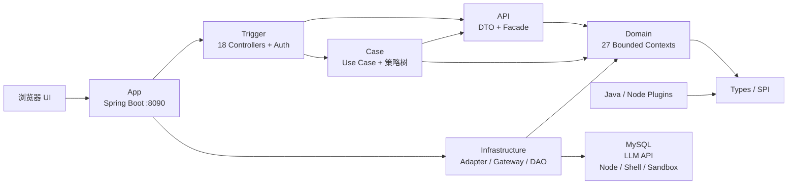
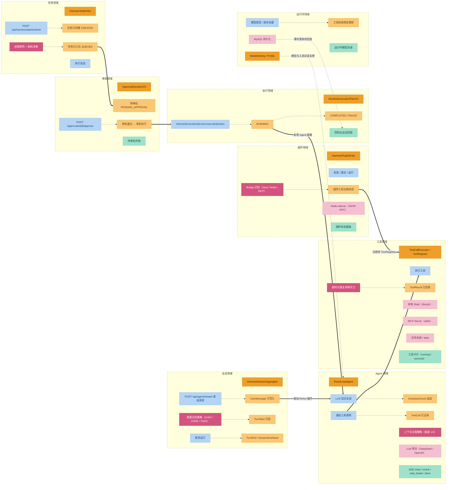

# DeepSeek Harness · Java Edition

`deepseek-harness-java` 是一个基于 **Java 17 + Spring Boot 3.3 + DDD 六边形架构** 的智能体运行时。它不只是 Chat UI 的后端封装，而是把模型调用、工具执行、会话事件、任务审批、插件生命周期、终端与工作区、工作流与后台作业组织成可扩展的 Agent Harness。

项目当前提供：

- 可交互的内置 Web 控制台；
- 普通 JSON 与 SSE 流式 Agent 对话；
- ReAct 式模型-工具循环；
- 文件、Shell、Web、MCP、插件工具；
- Java Native Plugin 与 Node Bridge Plugin 两类扩展模式；
- 会话、任务、目标、审批、模型设置的持久化；
- Standalone Profile 与统一 MySQL 持久化；
- Docker Compose 快速启动。

完整架构图见 [`docs/architecture.drawio`](docs/architecture.drawio)，可用 draw.io / diagrams.net 打开。领域模型与功能串联（事件风暴视角）见 [`docs/domain-design.md`](docs/domain-design.md)。插件开发细节见 [`docs/java-plugin-development.md`](docs/java-plugin-development.md)。

## 项目定位

这个工程适合作为以下场景的 Java 侧基座：

| 场景 | 项目提供的能力 |
| --- | --- |
| 本地智能体工作台 | 浏览器 UI、SSE 对话、Markdown 渲染、会话与工作区管理 |
| Java 原生 Agent 运行时 | Spring Boot 装配、ReAct Loop、工具注册与执行、会话事件 |
| 企业内部扩展平台 | Java SPI 插件、Node sidecar 插件、MCP 工具适配、插件生命周期 API |
| 任务自动化系统 | 任务提交、队列、审批、目标、计划、待办、工作流、后台作业 |
| 可替换基础设施 | Domain 定义端口，Infrastructure 提供数据库、LLM、执行环境适配 |

它当前定位为**单实例可运行 Agent Harness**，不是开箱即用的分布式多租户 SaaS。生产化部署前仍需要根据企业要求补充鉴权策略、审计、集群协调、可观测性和完整集成测试。

## 核心特性

### Agent 对话与执行

- `POST /api/agent/message`：阻塞式返回完整对话结果。
- `POST /api/agent/stream`：SSE 流式输出，事件包括 `meta`、`chunk`、`step_break`（工具调用边界，前端据此分段渲染工具卡片）、`done`、`error`。
- `ReactLoopAgent` 驱动模型输出、工具调用、工具结果回填和会话事件记录。
- 轻量意图分流：闲聊与澄清类消息可通过 `[no-tools]` 前缀跳过工具；任务、代码、文件路径类消息进入工具执行路径。
- 支持取消运行、查询状态、按 `agentId` 复用会话。

### 工具系统

内置工具覆盖常见 Agent 操作面：

| 类别 | 工具 / 机制 | 说明 |
| --- | --- | --- |
| 文件系统 | `fs_read`, `fs_search`, `fs_write`, `str_replace_editor` | 读取、搜索、写入和精确替换文件内容 |
| 进程执行 | `shell_execute` | 通过本地 Shell 执行命令，受审批与沙箱策略约束 |
| 网络 | `web_search`, `web_fetch` | 搜索与抓取网页内容 |
| 插件 | `plugin__<pluginId>__<toolName>` | Java Native 或 Node Bridge 插件工具 |
| MCP | `mcp__<serverName>__<toolName>` | MCP Server 工具适配 |
| 交互 | `ask_user_question` | 向用户发起澄清问题 |

工具调用经过统一 `ToolCallExecutor`，并写入 Session Event Log。默认配置中 `shell_execute`、`fs_write`、`plugin.run`、`subprocess.spawn` 被列为需要审批的高风险能力。

### 会话与任务治理

- Session Registry / Session Event / Session Log 支持会话创建、事件追加和历史回放。
- Task Submission / Queue / Execution / Permission / Approval 支持任务进入执行前的权限与审批链路。
- Goal、Plan、Todo 用于维护目标状态、执行计划和待办上下文。
- Schedule 和 Jobs 支持提醒与后台任务。
- Workflow 提供脚本编排、取消与 SSE 结果流。

### 模型与运行时

- `runtime` 域维护模型 Profile、模型设置与运行时工具绑定。
- `llm` 域抽象消息、内容块、工具调用、流式分片和 Token 用量。
- `DeepSeekAdapter` 与 `OpenAiCompatibleAdapter` 支持 OpenAI 兼容 Chat Completions 风格接口。
- 支持模型发现、模型设置增删查和默认模型配置。

### 安全与执行边界

- `ApiKeyAuthInterceptor` 支持 `X-API-Key` 与 `Authorization: Bearer ...`。
- `harness.auth.api-keys` 为空时，API 默认放行，便于本地开发。
- `guard` 提供工具超时策略和重复调用提醒。
- `hooks` 支持生命周期钩子，阻止类 Hook 输出优先。
- `sandbox` 与 `e2b` 提供本地路径边界和可替换的远程沙箱端口。

## 总体架构



### 依赖方向

架构保持以下核心约束：

```text
App → Trigger → API/Case → Domain ← Infrastructure
Domain → Types
Plugins → Types
```

- `Trigger` 不编写业务规则，只负责协议、认证、参数绑定和路由。
- `API` 暴露应用层 Facade 和 DTO，隔离外部协议与内部用例。
- `Case` 编排跨领域流程，不直接依赖具体数据库、HTTP Client 或进程实现。
- `Domain` 持有实体、值对象、领域服务、端口和仓库接口。
- `Infrastructure` 实现 Domain 端口，负责 MySQL、LLM、Node、Shell、Sandbox 等外部依赖。
- `Types` 是插件与工具的轻量 SPI 契约包，不依赖 Spring。

### Maven 模块

| 模块 | 职责 |
| --- | --- |
| `deepseek-harness-java-app` | Spring Boot 启动器、静态 UI、Profile 配置、预置插件加载 |
| `deepseek-harness-java-trigger` | 18 个 REST Controller、API Key 拦截器、Web MVC 配置 |
| `deepseek-harness-java-api` | 应用层 Facade、Command/Query DTO、响应对象 |
| `deepseek-harness-java-case` | Agent、Session、Task、Plugin 等用例编排 |
| `deepseek-harness-java-domain` | 27 个 Bounded Context、实体、值对象、端口与领域服务 |
| `deepseek-harness-java-infrastructure` | Repository、DAO、Gateway、协议和执行环境适配 |
| `deepseek-harness-java-types` | `JavaHarnessPlugin`、`AbstractTool`、`ToolDefinition` 等 SPI 契约 |
| `plugins/*` | 示例插件、插件 Archetype、Node Bridge Demo |
| `docs` | 架构图、领域设计详解、插件开发指南 |

## 领域设计

`domain` 模块共 27 个一级子包，遵循事件风暴（Event Storming）建模，六色图例贯穿下文。

### 事件风暴全景



两条业务主线：**对话主线**（会话 → Agent ReAct 循环 → 工具执行 → 插件扩展）与**任务主线**（任务提交 → 权限/审批 → 排队 → 执行，执行阶段复用 Agent 链路）；运行时领域横向提供模型 Profile 与工具目录支撑，过程事件落库供控制台回放。

### 限界上下文

| 能力面 | Bounded Contexts | 核心对象 |
| --- | --- | --- |
| Agent 执行核心 | `agent`, `llm`, `session` | `ReactLoopAgent`、`Phase`（Idle/Running/Maintenance）、`ILlmRuntimePort`、`HarnessSessionAggregate`、`SessionLog` |
| 任务与目标 | `task`, `goal`, `plan`, `todo`, `workflow`, `schedule`, `jobs` | `HarnessTaskEntity`、`GoalAggregate`、`WorkflowRun` |
| 工具与插件 | `tool`, `plugin`, `typert`, `sdk` | `ToolRegistry`、`ToolCallExecutor`、`RuntimeApprovalGate` |
| 运行时与环境 | `runtime`, `credentials`, `coderuntime`, `terminal`, `lsp`, `sandbox`, `e2b`, `acp` | `ModelSetting`、`Profile`、各类端口 |
| 治理与存储 | `guard`, `hooks`, `storage` | 超时策略、Hook 引擎、KV 存储 |
| 共享与技能 | `shared`, `skill` | `HarnessStatusEnumVO` 等跨域枚举 |

`task` 域按职责拆为五个子域：

| 子域 | 职责 | 关键对象 |
| --- | --- | --- |
| `submission` | 提交参数校验与过滤 | `TaskSubmissionVO` |
| `permission` | 权限矩阵评估 | `PermissionAssessmentVO`、`IPermissionMatrixPort` |
| `approval` | 审批决策与命令 | `ApprovalDecisionVO`、`ApprovalPolicyService`、`ApprovalCommandService` |
| `queue` | 任务队列持久化 | `IHarnessTaskQueueRepository` |
| `execution` | 会话执行 | `HarnessExecutionService`、`IModelExecutionPort` |

`plugin` 域拆为三条边界：**Registry**（`PluginRegistryService`，安装/元数据/启停）、**Bridge**（`PluginBridgeService`，识别 `JAVA_NATIVE`/`DSH_NODE_BRIDGE`/`CODEX`/`CORDIS` 并生成绑定计划）、**Runtime**（`PluginRuntimeService`，启动/停止/查询实例）。

### 核心聚合

- **Agent**：聚合根服务 `ReactLoopAgent`，持有 `SessionLog`、`Inbox`、`ILlmRuntimePort`、`ToolRegistry`、`ToolCallExecutor`、`SystemPromptAssembler`。单 turn 上限 50 步，max_tokens 受控续写最多 4 次，工具调用后经 `midTurnContinuation` 标志跳过 inbox 检查直接续步；取消用 `AtomicBoolean` + 100ms 轮询。
- **会话**：聚合根 `HarnessSessionAggregate`；`SessionLog` 为内存追加式 WAL，`SurfaceProjector` 将事件投影为 `SurfaceOp`（Append/Replace）；`BasicCompactionEngine` 保留最近 1/4 事件，其余由 LLM 总结。
- **任务**：`HarnessTaskEntity`，状态机 `CREATED → PENDING_APPROVAL → QUEUED → RUNNING → COMPLETED/FAILED`。
- **目标**：`GoalAggregate`（`GoalAction`、`GoalSnapshotVO`、`GoalStatus`），`IGoalRepository` 持久化。

### 领域事件机制

无通用 `DomainEvent` 基类，**事件机制即会话事件日志（Session Event Log）的事件溯源**。`SessionEvent` 为 sealed 接口：

| 类别 | 事件 |
| --- | --- |
| 轮/步边界 | `TurnStart`、`TurnEnd(reason)`、`StepStart`、`StepEnd` |
| 消息 | `UserMessage`、`AssistantChunk`、`AssistantMessage` |
| 工具 | `ToolCall(callId, name, arguments)`、`ToolResult(callId, ...)` |
| 其他 | `TodoWrite`、`RequestHeader`、`RequestContext`、`SessionEndSeed`、`PlanModeChange`、`AgentInboxSpliced` |

流式对话的 SSE 事件与领域事件对应：`meta`（起始帧）、`chunk`（AssistantChunk 文本增量）、`step_break`（工具调用边界，前端据此插入工具卡片并重置消息气泡）、`done`（终态 + 全量 messages 含 tool 角色，供前端重建工具卡片状态）、`error`。

### 策略树：功能如何串联

跨领域编排在 `case` 模块完成，统一用 `AbstractStrategyRouter` 责任链（`doApply` 处理当前节点，`getNext` 返回后继）。

**Agent 消息链**（以 `POST /api/agent/stream` 为例）：

```text
浏览器 UI → AgentController → AgentUseCase
  → AgentResolveNode   按 agentId 复用/创建 Agent，解析模型、Token、工作目录
  → AgentIntentNode    正则规则分类 CHAT / CODE_QUESTION / TASK_EXECUTION / CLARIFICATION
  → AgentDispatchNode  构造用户消息，agent.send(userMessage, NEXT_TURN, true)
  → AgentCollectNode   等待空闲，投影 User/Assistant/ToolCall/ToolResult 消息，按 callId 合并
  → ReactLoopAgent     LLM 流式 → append AssistantChunk → ToolCallExecutor → append ToolCall/ToolResult
  → SSE 推送 chunk / step_break / done
```

**任务提交链**：

```text
SubmissionRootNode → ProfileResolutionNode → PermissionCheckNode → ToolResolutionNode → EnqueueNode
```

- `PermissionCheckNode`：`assess(tools)` → `decide(profile, assessment)` → `ApprovalDecisionVO`。
- `EnqueueNode`：建会话（QUEUED）+ 建任务 + 记日志；免审批直接 `executeSession`（RUNNING），需审批停留 `PENDING_APPROVAL`。

**审批恢复**：`approve(sessionId)` → 状态 QUEUED 落库 → `HarnessExecutionService.executeSession` → RUNNING → COMPLETED/FAILED。执行入口对 `PENDING_APPROVAL` 直接抛异常兜底。

**插件生命周期**：`install`（落 `HarnessPluginEntity`）→ `activate`（Bridge 识别 + recordBinding）→ `run`（`PluginRuntimeService.start`）。插件工具以 `plugin__<pluginId>__<toolName>` 注册进 `ToolRegistry`，之后与内置工具走同一套 Hook/守卫/事件回填链路。

**工作流**：`IWorkflowService.start` → `IWorkflowEnginePort`（`LocalWorkflowEnginePort`）→ `WorkflowRun`（CompletableFuture），流式复用 `ReactLoopAgent` 的 deltaSink/toolCallSink 推 SSE。

### 端口-适配器对照

Domain 定义端口，Infrastructure 实现。关键端口：

| Domain 端口 | Infrastructure 实现 |
| --- | --- |
| `ILlmRuntimePort` | `InMemoryLlmRuntimePort`（流式生成，重试在此层） |
| `IModelExecutionPort` | `ModelExecutionPort` |
| `IModelProviderPort` | `ModelProviderPort` |
| `IRuntimeApprovalBroker` | `RuntimeApprovalBroker` |
| `IPermissionMatrixPort` / `IApprovalPolicyPort` | `PermissionMatrixPort` / `ApprovalPolicyPort` |
| `IToolCatalogPort` | `ToolCatalogPort` |
| `IPluginArtifactInstallerPort` / `IPluginRuntimeBridgePort` / `IPluginProcessPort` | `PluginArtifactInstallerPort` / `PluginRuntimeBridgePort` / `PluginProcessPort` |
| `IHarnessSessionRepository` / `ISessionEventStore` / `IHarnessTaskQueueRepository` / `IGoalRepository` | MyBatis Repository 对应实现 |
| `IWorkflowEnginePort` | `LocalWorkflowEnginePort` |
| `AgentFactoryPort` | `AgentFactory`（组合根：装配 `ReactLoopAgent` + `ToolCallExecutor`） |

更完整的领域说明（事件清单、全部端口、子域细节）见 [`docs/domain-design.md`](docs/domain-design.md)。

## Web 控制台

启动后访问：

```text
http://localhost:8090/
```

内置静态前端位于 `deepseek-harness-java-app/src/main/resources/static`，主要由原生 JavaScript 实现，本地化加载以下渲染库：

- `marked.min.js`：Markdown 解析；
- `purify.min.js`：HTML 安全过滤；
- `highlight-core.min.js` / `highlight-common.min.js`：代码高亮。

控制台覆盖的主要操作：

- 新建、切换、重命名、删除工作区；
- 创建和恢复 Agent 会话；
- 发送普通消息或流式消息；
- 取消正在运行的 Agent；
- 查询、保存、删除和发现模型；
- 查看和启停插件；
- 查看待审批任务并执行审批；
- 查看历史会话与消息。

## REST API 概览

以下是最常用的 API 分组；路径均为 Spring Boot 实际暴露路径。

| 分组 | 端点示例 | 说明 |
| --- | --- | --- |
| Agent | `POST /api/agent/message`, `POST /api/agent/stream` | 普通对话与 SSE 流式对话 |
| Agent 控制 | `GET /api/agent/{agentId}/status`, `POST /api/agent/{agentId}/cancel` | 查询状态和取消运行 |
| 工作区 | `GET /api/agent/workspaces`, `POST /api/agent/workspaces` | 查询、创建、重命名、排序、删除工作区 |
| 任务 | `POST /api/harness/tasks/submit` | 提交 Harness Task |
| 目标 | `GET /api/harness/goals/{sessionId}`, `POST /api/harness/goals/{sessionId}` | 查询与维护目标状态 |
| 审批 | `GET /api/harness/approvals/pending`, `POST /api/harness/approvals/{sessionId}/approve` | 查询待审批项并审批 |
| 模型设置 | `GET /api/harness/settings/models`, `POST /api/harness/settings/models` | 查询、保存、删除模型设置 |
| 模型发现 | `POST /api/harness/settings/models/discover`, `GET /api/harness/runtime/models` | 发现模型和查询运行时目录 |
| 插件 | `GET /api/harness/plugins`, `POST /api/harness/plugins/install` | 插件列表、安装、激活、运行、启停、卸载 |
| 终端 | `POST /api/harness/terminal/sessions`, `GET /api/harness/terminal/sessions/{id}/read` | 打开、发送、读取、关闭终端 |
| 工作流 | `POST /api/workflow/start`, `POST /api/workflow/stream` | 启动工作流、取消和 SSE 输出 |
| 控制台 | `GET /api/harness/console/sessions`, `GET /api/harness/console/sessions/{id}/messages` | 会话与消息回放 |

### Agent 对话示例

```bash
curl -X POST http://localhost:8090/api/agent/message \
  -H 'Content-Type: application/json' \
  -d '{
    "agentId": "local-agent",
    "message": "Hello!",
    "provider": "deepseek",
    "model": "gpt-5.5",
    "maxTokens": 8192,
    "cwd": "."
  }'
```

`agentId` 和 `message` 必填。`provider`、`model`、`maxTokens`、`cwd` 可省略，省略后使用默认模型设置。

流式对话：

```bash
curl -N -X POST http://localhost:8090/api/agent/stream \
  -H 'Content-Type: application/json' \
  -d '{
    "agentId": "local-agent",
    "message": "介绍这个项目的架构"
  }'
```

如果启用了 API Key，需要额外携带：

```bash
-H 'X-API-Key: your-api-key'
```

或：

```bash
-H 'Authorization: Bearer your-api-key'
```

## 本地运行

### 环境要求

| 软件 | 版本 | 必需性 |
| --- | --- | --- |
| JDK | 17+ | 必需 |
| Maven | 3.9+ | 构建必需 |
| Node.js | 18+ | 使用 Node Bridge Plugin 时必需 |
| MySQL | 5.7+ | 外部依赖 Profile 使用 |
| Docker | 24+ | 可选，用于 Compose 启动 |

### 构建与验证

```bash
mvn clean verify
```

如果只想快速打包，可跳过测试：

```bash
mvn clean package -DskipTests
```

构建产物位于：

```text
deepseek-harness-java-app/target/deepseek-harness-java-app-1.0.0-SNAPSHOT.jar
```

### Standalone 模式

Standalone Profile 复用主配置中的 MySQL 数据源，适合本机开发和演示。

```bash
export DEEPSEEK_API_KEY='your-model-api-key'

java -jar deepseek-harness-java-app/target/deepseek-harness-java-app-1.0.0-SNAPSHOT.jar \
  --spring.profiles.active=standalone
```

如需覆盖默认模型服务：

```bash
java -jar deepseek-harness-java-app/target/deepseek-harness-java-app-1.0.0-SNAPSHOT.jar \
  --spring.profiles.active=standalone \
  --harness.llm.deepseek.base-url='http://127.0.0.1:8777/v1' \
  --harness.llm.deepseek.api-key="$DEEPSEEK_API_KEY" \
  --harness.llm.deepseek.default-model='glm_for_coding'
```

Standalone 模式的数据文件默认写入：

```text
./data/deepseek-harness-java.mv.db
```

### MySQL 模式

默认 `application.yml` 面向外部 MySQL。生产或联调环境可以通过环境变量覆盖连接信息：

```bash
export SPRING_DATASOURCE_URL='jdbc:mysql://mysql.example.com:3306/deepseek_harness_java?useUnicode=true&characterEncoding=UTF-8&serverTimezone=Asia/Shanghai&useSSL=false&allowPublicKeyRetrieval=true'
export SPRING_DATASOURCE_USERNAME='your-db-user'
export SPRING_DATASOURCE_PASSWORD='your-db-password'
java -jar deepseek-harness-java-app/target/deepseek-harness-java-app-1.0.0-SNAPSHOT.jar
```

应用启动时会执行 `deepseek-harness-java-app/src/main/resources/schema.sql`，确保主要表结构存在。

### Docker Compose

```bash
docker compose up --build -d
```

Compose 配置：

- 暴露 `8090:8090`；
- 默认使用 `standalone` Profile；
- 挂载 `./data`、`./plugins`、`./.dsh`、`./workspaces`；
- 通过 `DEEPSEEK_API_KEY` 和 `OPENAI_API_KEY` 注入模型凭据。

## 关键配置

| 配置项 | 作用 | 说明 |
| --- | --- | --- |
| `server.port` | HTTP 端口 | 默认 `8090` |
| `spring.datasource.*` | JDBC 数据源 | 统一使用 MySQL |
| `harness.llm.deepseek.base-url` | 模型 API 地址 | 支持 OpenAI-compatible Chat Completions |
| `harness.llm.deepseek.api-key` | 模型 API Key | 建议用环境变量注入 |
| `harness.llm.deepseek.default-model` | 默认模型 | 例如 `glm_for_coding` |
| `harness.auth.api-keys` | 宿主 API Key 列表 | 多个 Key 用英文逗号分隔；为空则本地放行 |
| `harness.approval.required-tools` | 需要审批的工具 | 默认包含 Shell、文件写入等高风险工具 |
| `harness.approval.required-profiles` | 需要审批的 Profile | 可按执行档位控制审批 |
| `harness.plugin.install-root` | 插件安装根目录 | 默认 `./plugins` |
| `harness.plugin.preset.plugins` | 启动预装插件 | 支持设置 `auto-enable` |
| `harness.agent.temperature` | LLM 采样温度 | 系统属性/环境变量；为空则不发送该参数（适配只接受 temperature=1 的网关） |

## 插件与扩展

### Java Native Plugin

Java Native Plugin 以 JAR 方式安装，宿主使用隔离 `URLClassLoader` 加载：

1. 实现 `JavaHarnessPlugin` 或继承 `AbstractHarnessPlugin`。
2. 实现 `AbstractTool`，声明 `name()`、`description()`、`parameters()`、`run()`。
3. 在 `META-INF/plugin.yaml` 中声明插件元数据。
4. 在 `META-INF/services/cn.walioffice.deepseek.harness.domain.plugin.spi.JavaHarnessPlugin` 中注册入口类。
5. 打包为 JAR 并放入 `harness.plugin.install-root` 指向的目录。

插件工具注册后的名称格式：

```text
plugin__<pluginId>__<toolName>
```

### Node Bridge Plugin

`DSH_NODE_BRIDGE` 用于兼容现有 Node 侧插件：

- 插件包复制到 `harness.plugin.install-root`；
- 识别 `.codex-plugin/plugin.json`、`package.json`、`cordis.yml` 入口；
- 对可执行的 Node 插件生成受限 `node <entrypoint>` 运行计划；
- 通过 sidecar 进程运行，不经 Shell 拼接；
- 入口限制在插件安装目录内的 `.js`、`.mjs`、`.cjs` 文件。

### 插件生命周期

```text
install → activate → run → disable → uninstall
```

完整 Archetype 命令、代码模板和 HTTP 安装示例见 [`docs/java-plugin-development.md`](docs/java-plugin-development.md)。

## 持久化模型

`schema.sql` 当前初始化的主要表包括：

| 表 | 用途 |
| --- | --- |
| `harness_session` | Session 聚合基础状态 |
| `harness_session_header` | 会话请求头与上下文折叠状态 |
| `harness_session_event` / `harness_session_event_log` | 会话与 Agent 过程事件 |
| `harness_task` | 任务提交与执行状态 |
| `harness_goal_state` | 目标状态 |
| `harness_plugin_installation` | 插件安装元数据 |
| `harness_plugin_runtime_binding` | 插件运行绑定信息 |
| `harness_model_setting` | 模型与 Provider 配置 |
| `harness_tool_catalog` / `harness_tool_profile_binding` | 工具目录与 Profile 绑定 |

MySQL 承载结构化状态和事件（默认 profile）；standalone profile 使用 H2 文件库，两者共用同一套 schema。

## 生产化注意事项

生产部署前建议完成以下检查：

1. **认证**：配置 `harness.auth.api-keys`，不要将本机服务直接暴露到公网。
2. **密钥管理**：通过环境变量、启动参数或外部密钥管理系统注入模型 API Key。
3. **审批策略**：确认 Shell、文件写入、插件执行和子进程等高风险工具是否必须审批。
4. **沙箱边界**：限制 `cwd`、`workspaces`、`plugins`、`data` 的目录权限；优先使用独立容器或远程沙箱。
5. **数据库**：使用外部 MySQL，配置连接池、备份和事件表归档策略。
6. **可观测性**：接入日志采集、Metrics、Tracing 和关键业务审计。
7. **横向扩展**：当前设计为单实例 Agent 运行时；多实例部署前需要处理 Agent 内存状态、任务锁和会话亲和性。

## 当前边界

- 项目已从早期骨架演进为可运行 Agent Harness，但仍不是承诺企业级 SLA 的完整产品。
- 部分外部能力依赖可选环境：E2B、ACP、MCP、Codex/Claude Code Subagent 等需要对应服务或命令存在。
- Agent 的运行状态和流式执行链路偏向单实例模型；分布式任务调度尚未完整引入。
- API 认证目前是简单 API Key 拦截器，还不是多租户身份体系。
- **运行期审批 gate 默认未启用**：审批只在任务提交期拦截（`PermissionCheckNode`）；`AgentFactory` 默认构造时 `approvalBroker=null`，工具执行器走 allowAll，对话链路里的高风险工具不受运行期拦截。
- **`shell_execute` 零沙箱**：`LocalShellExecutor` 直接 `/bin/sh -c`，无命令白名单，仅靠提交期审批兜底；生产环境务必配合审批策略与容器隔离。
- **`ScheduleService` 无驱动方**：`drive()` 无 `@Scheduled`/Quartz 调用方，且仓储为 InMemory，重启即丢。
- **线程池与阻塞**：`ReactLoopAgent.kick()` 与 `JobRegistryService` 用无界 `newCachedThreadPool`；`AgentCollectNode` 用 `.join()` 阻塞请求线程，高并发下需关注。
- **长会话性能**：`deriveMessages` 全量重建 O(n²)；token 预算用 `length/4` 粗估。
- **Stub/死路径**：E2B 沙箱只有 Stub 实现；CODEX/CORDIS 插件包型识别后 runnable=false；MCP 与插件 Bridge 互不打通；工作流 SSE 只推终态事件。
